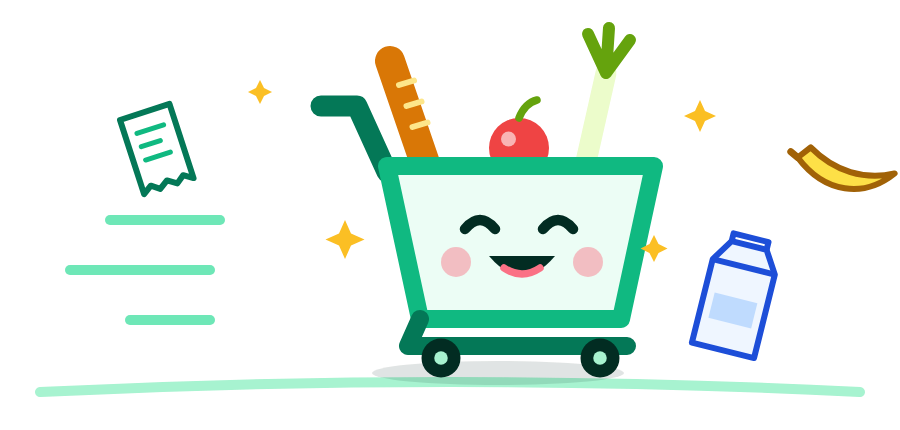
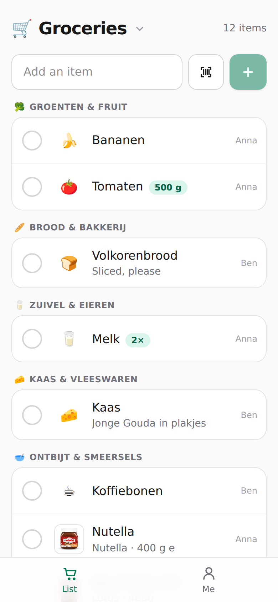
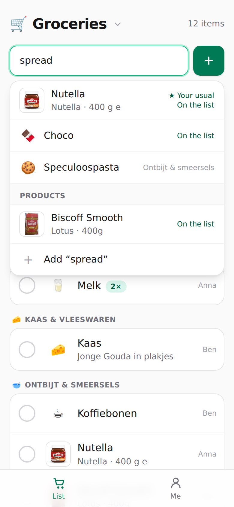
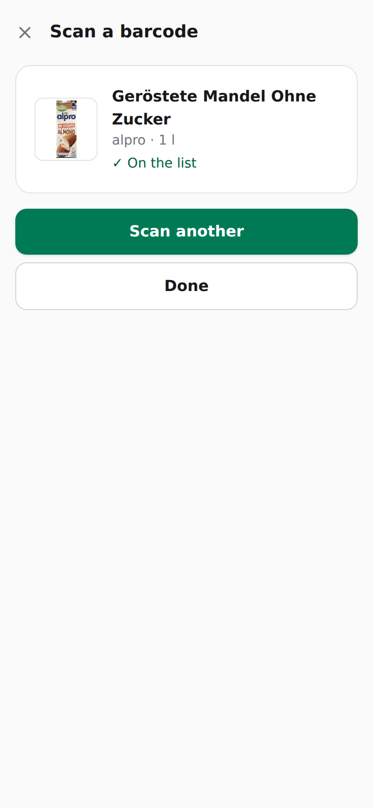
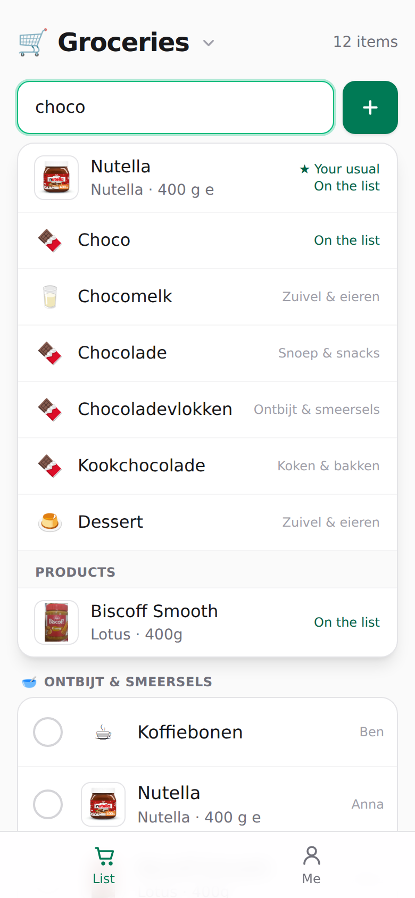
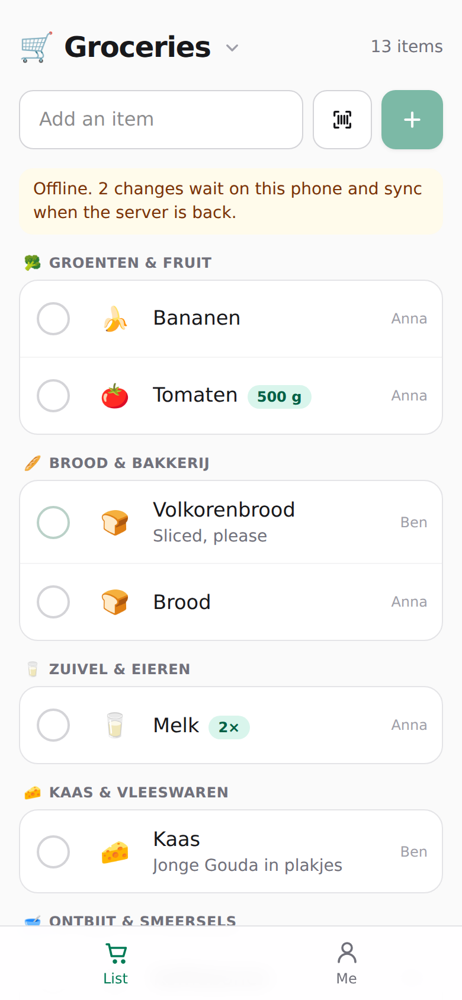
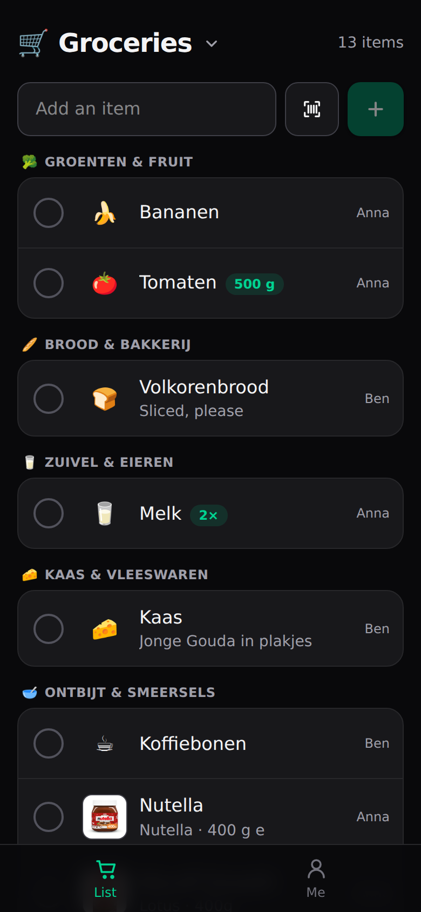
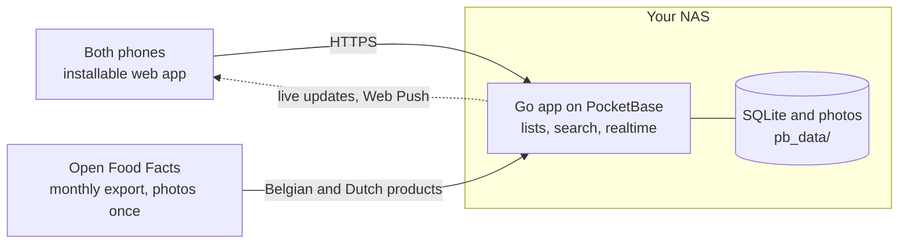

<div align="center">



# Shoppa

**A shared shopping list for your household, on your own hardware.**

</div>

Shoppa is a self-hosted shopping list, like Bring!, made for Belgium. Add "melk" and
it shows up on the other phone at once, with its emoji and in the shop's order of
sections. Or pick the exact product, from Open Food Facts or by scanning the empty
package, and the other person sees its photo, brand and size, so they bring home the
right one. Meet Carty (Mr. Shopping Carty, to strangers), who keeps the bananas warm
while you shop.

<table>
  <tr>
    <td align="center" width="33%"><br><sub><b>One list, on every phone.</b> Grouped by section, live as it changes.</sub></td>
    <td align="center" width="33%"><br><sub><b>The exact product.</b> Belgian and Dutch products, found in your own words.</sub></td>
    <td align="center" width="33%"><br><sub><b>Scan the empty package.</b> It goes on the list as that product.</sub></td>
  </tr>
  <tr>
    <td align="center"><br><sub><b>Your usual first.</b> Pin "choco" to the jar you buy, once.</sub></td>
    <td align="center"><br><sub><b>No signal in the shop?</b> Tick off anyway; it syncs later.</sub></td>
    <td align="center"><br><sub><b>Light and dark.</b> An installable app that follows your phone.</sub></td>
  </tr>
</table>

## What it does

- **Lists for the household**, synced live between phones: Groceries, the weekend
  BBQ, the DIY store.
- **Add fast.** Type and pick: everyday items with an emoji ("melk", "bananen",
  "brood"), exact products with brand, size and photo, or anything you type. "2 melk"
  and "melk x2" both mean two.
- **Scan a barcode** of the empty package at home to put that exact product on the list.
- **Pin your usual.** Turn "melk" into "Boni halfvolle melk 1 L" once, and next time
  "melk" suggests it first.
- **A quantity and a note** on any item ("2×", "the big one").
- **Tick off in the shop.** What you bought moves to Recently bought, where one tap
  puts it back.
- **Works offline.** The list opens and ticks off without a connection, and syncs
  once the server is back.
- **One notification, not ten:** "Anna added 3 items to Groceries", sent once she's done.
- **Each person's language.** Item and product names in Dutch, French, English or
  Greek, chosen per person; the interface is in English and ready for translations.
- **Product photos stay home.** Each is downloaded once into your server, so the
  phones never contact Open Food Facts.

It is built on [plasto](https://github.com/selfhostit/plasto); [docs/plan.md](docs/plan.md)
has the architecture, the build plan and where things stand.

## Quick start

You need [Go](https://go.dev/dl/) 1.27+, [Node](https://nodejs.org) 22+ and
[uv](https://docs.astral.sh/uv/) (for the Python workers).

```sh
make setup   # install dependencies
make dev     # backend on :8090, web app with live reload on http://localhost:5173
```

Open the app and create your account with the setup code that `make dev` prints:
you become the **owner** and can also sign in to the admin UI at http://localhost:8090/_/ with the same email and
password. Add the rest of the household there, in the `users` collection.

A minute after it first starts, the server reads the Open Food Facts export (about a
gigabyte, streamed) and keeps the Belgian and Dutch products; after that it does so
on the 10th of each month. Set `SHOPPA_AUTO_IMPORT=off` to skip the first one.

## Food data

Product data comes from [Open Food Facts](https://world.openfoodfacts.org), under the
[Open Database Licence](https://opendatacommons.org/licenses/odbl/1-0/). Product
photos are by Open Food Facts contributors, under
[CC BY-SA 3.0](https://creativecommons.org/licenses/by-sa/3.0/). The reading of the
export is shared with [Troye](https://github.com/selfhostit/troye), in
[selfhostit/food](https://github.com/selfhostit/food).

## How it fits together



The phones only ever talk to your NAS. The NAS reads the Open Food Facts export once
a month, keeps only the Belgian and Dutch products (no nutrients), and downloads a
product's small photo the first time someone puts it on a list.

## Deploy

On any Linux machine with Docker (a NAS, a Raspberry Pi, a server):

```sh
curl -fsSL https://raw.githubusercontent.com/selfhostit/shoppa/main/deploy/install.sh | sh
```

It asks for a Tailscale auth key, so your devices reach the app at
`https://shoppa.<your-tailnet>.ts.net`, and starts it with Docker Compose. See
[docs/deploy.md](docs/deploy.md) for updates, backups, workers, Synology and the Pi,
and [docs/synology.md](docs/synology.md) for the whole household setup on a Synology NAS.

## Layout

```
backend/            Go app on PocketBase
  main.go           entry point
  app/              routes, hooks and jobs (start here)
  catalogue/        the everyday items, their names and sections
  products/         Open Food Facts products and their photos
  jobs/             scheduled jobs with catch-up
  push/             Web Push: keys, subscriptions, sending
  migrations/       database schema as code
web/                Svelte 5 + Tailwind web app
  src/App.svelte    picks setup, sign-in or the app
  src/components/   screens; ListScreen.svelte is the list
  src/lib/          the list, search, offline queue and their tests
  public/           manifest, service worker and icons
workers/            Python worker kit, your workers, their tests and image
deploy/             compose files, Tailscale sidecar, install script, smoke test
docs/               the plan, the brand, the deploy guide and the first-feature guide
Dockerfile          the app's multi-arch image
Makefile            run `make` to see every command
```

## Commands

| Command      | What it does                                          |
| ------------ | ----------------------------------------------------- |
| `make dev`   | Run everything with live reload                       |
| `make check` | Format, lint and type-check                           |
| `make test`  | Run the Go, web and worker tests                      |
| `make build` | Build `dist/shoppa` with the web app next to it       |
| `make run`   | Build the Docker image and run it on :8090            |
| `make smoke` | Deploy both images with Compose and test end to end   |

Pushes to `main` publish `ghcr.io/selfhostit/shoppa` and
`ghcr.io/selfhostit/shoppa-worker` for amd64, arm64 and armv7; a `v*` tag
publishes that version.

## Security and maintenance

- **Not on the internet:** the container listens on `127.0.0.1` only; reach it through
  Tailscale or your own reverse proxy with HTTPS (`deploy/docker-compose.yml`).
- **Locked-down container:** runs as a normal user, drops every Linux capability and
  can't gain new ones; its filesystem is read-only apart from its data.
- **Nobody claims a new install before you:** the first account needs the one-time setup
  code the install prints (`backend/app/setup.go`).
- **Sign-ins are rate limited** (10 a minute, `backend/migrations/*_rate_limits.go`), and the
  web app sends a Content Security Policy (`backend/app/headers.go`).
- **Tested on every change:** Go, web and Python worker tests and an end-to-end run of the published images
  (`make smoke`) in [CI](.github/workflows/ci.yml); Actions are pinned to commit hashes and
  Dependabot keeps Go, npm, Python, Docker and Actions dependencies current.
- **Security scans** on every pull request and every week: CodeQL, Grype on the
  dependencies and the released images, dependency review and gitleaks
  ([security.yml](.github/workflows/security.yml)).
- **Versioned releases:** installs update to a release, not to every change on `main`, and
  every image has a signed attestation of the commit and workflow that built it
  ([CHANGELOG.md](CHANGELOG.md), [docs/deploy.md](docs/deploy.md#check-where-an-image-came-from)).
- **No analytics or tracking,** and no account anywhere else: the data stays in `pb_data` on
  your machine, with a nightly backup kept there. Only product lookups and photos from Open
  Food Facts come in, fetched by the server, never by the phones.

Found a security problem? Please report it privately, not in an issue: see [SECURITY.md](SECURITY.md)
for how, and how quickly it gets fixed. [Security and privacy](https://github.com/selfhostit/docs/blob/main/security.md) covers every selfhostit app:
what protects an install, what you are trusting and what is not done yet.

## Support

If Shoppa saves you a trip back to the shop, you can [buy me a coffee](https://buymeacoffee.com/kalfasyan).

## License

MIT
