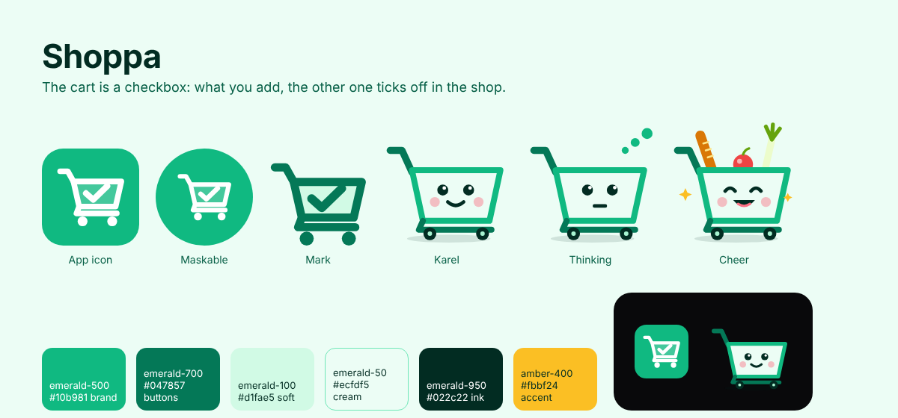

# Shoppa brand

Shoppa's look is built around one idea: **the cart is a checkbox**. The basket of the
cart holds a tick, which is what Shoppa is for: one of you adds things, the other ticks
them off in the shop. The icon, the mark and the mascot all use that cart, so the brand
and the list speak the same language.



## Assets

All files are SVG in `web/public/brand/` unless noted, so the web app serves them at `/brand/...`.

| File | Use |
| --- | --- |
| `web/public/icons/icon.svg` | App icon: favicon, sign-in header, anywhere a square logo fits |
| `web/public/icons/*.png` | PWA and home-screen icons, rendered from the SVGs |
| `icon-maskable.svg` | Full-bleed icon source for `icon-maskable-512.png` and `apple-touch-icon.png` |
| `mark.svg` | The cart alone, on transparent, for next to text |
| `carty.svg` | Mascot, default (happy) |
| `carty-thinking.svg` | Mascot while searching or looking a barcode up |
| `carty-cheer.svg` | Mascot for a list that's all done, with groceries sticking out |
| `avatar-default.svg` | User avatar before they add a photo (light theme) |
| `avatar-default-dark.svg` | Same, for dark theme |

There is no wordmark: set "Shoppa" in the app's sans font, in bold.

To regenerate the PNG icons after changing an SVG, render each at its size with any SVG
renderer, for example:

```sh
cd web/public
rsvg-convert -w 192 icons/icon.svg -o icons/icon-192.png
rsvg-convert -w 512 icons/icon.svg -o icons/icon-512.png
rsvg-convert -w 512 brand/icon-maskable.svg -o icons/icon-maskable-512.png
rsvg-convert -w 180 brand/icon-maskable.svg -o icons/apple-touch-icon.png
```

## Logo

- The cart faces right, with the handle top left, and the tick sits inside the basket.
  Keep the tick: without it, it's any shop's cart.
- Keep clear space around the icon of at least the cart's stroke width.
- Smallest size: icon 16 px.
- Don't recolor the cart per screen, add outlines or shadows, or stretch it.
- The name is written **Shoppa** in text.

## Mascot: Carty

Carty (short for Mr. Shopping Carty) is a small Flemish shopping cart with a face on the front of his basket. He rolls
along in empty states, while searching, and when a list is done.

- Voice: friendly, short, a little cheeky, never fussy. He talks about the shopping,
  not about the people doing it. Example: "All done! See you next week, I'll keep the
  bananas warm."
- Pick the state that matches the moment: `carty` to talk, `carty-thinking` while
  searching or scanning, `carty-cheer` for a finished list. A full basket is part of
  the cheer: it is kept for wins.
- Carty is the app's own voice. People get `avatar-default` until they add a photo.

## Color

The palette is Tailwind's emerald family plus an amber accent, so every value is a
Tailwind class.

| Role | Value | Tailwind |
| --- | --- | --- |
| Brand green (icon, cart) | `#10b981` | `emerald-500` |
| Buttons and links | `#047857` | `emerald-700` (`brand-600` in `app.css`) |
| Soft fills, the basket | `#d1fae5` | `emerald-100` |
| Cream background | `#ecfdf5` | `emerald-50` |
| Ink (Carty's face, wheels) | `#022c22` | `emerald-950` |
| Accent (sparkles, highlights) | `#fbbf24` | `amber-400` |

`--color-brand-*` in `web/src/app.css` maps the brand to emerald. Buttons use `brand-600`
with white text, which is mapped to `emerald-700` so the text keeps WCAG AA contrast;
bright `emerald-500` is for shapes and icons, not for text on white.
